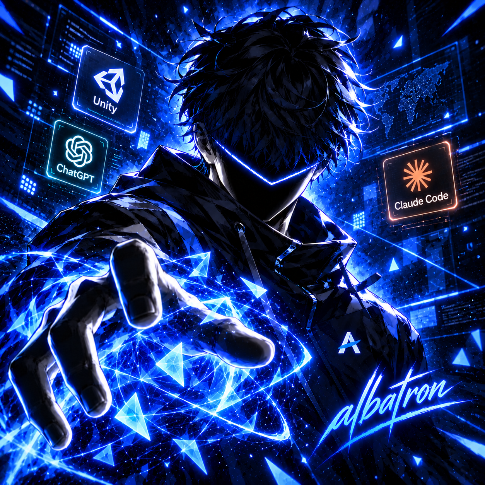

<!-- Main brand banner: artwork supplied by Albert -->

 

<h1>Albert Siraev / albatron</h1>

**Team Lead Unity Developer · VR Multiplayer · Architecture · AI-powered Tools**

---

## About me

<table>
<tr>
<td width="25%" align="center" valign="middle"></td>
<td width="75%" valign="middle">

I'm a **Team Lead Unity Developer with 5+ years of experience** shipping VR/AR, multiplayer and cross-platform applications. I focus on **software architecture, real-time multiplayer, performance optimization**, and tools that make game-development teams faster.

Currently leading Unity development of a **VR multiplayer project for a Dubai-based company**. I work closely with the art lead to turn client requirements into interactive scenarios, using **Addressables, Final IK, UI Toolkit and VContainer**.

Outside core gameplay development, I create **AI-assisted Unity tools** — from MCP-connected knowledge bases to UI-generation and cross-device workflows.

</td>
</tr>
</table>

## Engineering impact

<table>
<tr>
<td align="center" width="25%"><b>5+ years</b> Unity development</td>
<td align="center" width="25%"><b>Up to 50</b> concurrent players</td>
<td align="center" width="25%"><b>~20 → 60 FPS</b> console port optimization</td>
<td align="center" width="25%"><b>1–2 MB → ~40 KB</b> GC allocations reduced</td>
</tr>
</table>

- **Technical leadership:** led a team of 5 Unity developers, owned architectural decisions and established engineering workflows.
- **Developer efficiency:** created a reusable Unity Package Manager framework, reducing new-project setup time by **30–40%**.
- **Performance:** achieved a **20% mobile rendering FPS improvement** on a previous project.
- **Production experience:** shipped cross-platform applications, including products reaching **50k+ users**.

These results come from different roles and projects, as described in my CV.

## Featured projects & tools

<table>
<tr>
<td width="47%"></td>
<td width="53%">
<h3>VR Multiplayer — Team Lead</h3>

<b>Current role · Dubai-based company</b>

Leading Unity development on a VR multiplayer experience. Translating client requirements into interactive scenarios with the art lead, while overseeing the implementation of gameplay systems and Unity workflows.

<b>Stack:</b> Unity, C#, Addressables, Final IK, UI Toolkit, VContainer.

<i>Commercial work: implementation and visuals are shared only when permitted.</i>

</td>
</tr>
<tr>
<td width="47%"></td>
<td width="53%">
<h3>Unity Asset Store — Under Review</h3>

Created a Unity asset and submitted it to the Asset Store for review. A developer-facing product built with an emphasis on reusable tooling and usability.

<a href="https://u3d.as/4eLq"><b>View Asset Store listing ↗</b></a>

The listing may not be publicly accessible until Unity approves the asset.

</td>
</tr>
<tr>
<td width="47%"></td>
<td width="53%">
<h3>AI Knowledge Base + MCP Unity</h3>

Designed an AI knowledge base integrated with <b>MCP Unity</b> to provide structured context for AI-assisted Unity development.

<b>Focus:</b> knowledge organization, development context and AI / Unity tool integration.

</td>
</tr>
<tr>
<td width="47%"></td>
<td width="53%">
<h3>Harness Companion App — PC ↔ Mobile</h3>

Developed an application for working with a harness across <b>PC and mobile</b>, connecting development workflows between devices.

<b>Focus:</b> cross-device interaction and developer tools.

</td>
</tr>
<tr>
<td width="47%"></td>
<td width="53%">
<h3>UI Toolkit Panel Generation with Claude Code</h3>

Created an algorithm for generating <b>Unity UI Toolkit panels</b> through <b>Claude Code</b>.

<b>Focus:</b> UI authoring automation and AI-assisted development workflows.

</td>
</tr>
</table>

## Tech stack

**Unity & architecture**  
`Unity` · `C#` · `VContainer` · `UI Toolkit` · `Addressables` · `Final IK` · `UPM` · `Modular Architecture`

**Multiplayer & optimization**  
`Mirror` · `FishNet` · `Networking` · `Unity Jobs` · `Burst` · `GC Optimization` · `Shader & Rendering Optimization`

**AI, backend & tooling**  
`MCP Unity` · `Claude Code` · `AI Knowledge Systems` · `Python` · `Django REST` · `PostgreSQL` · `Docker` · `GitLab CI/CD`

**Platforms**  
`VR/AR` · `PC` · `WebGL` · `Android` · `iOS` · `PlayStation` · `Xbox` · `Nintendo Switch`

## Experience

- **Current** — Team Lead Unity Developer, Dubai-based company · VR Multiplayer.
- **2025–2026** — Contract Unity Developer · cross-platform products, console porting, backend integration.
- **2024–2025** — Unity Developer Team Lead, Square Dino LLC · 5-person team, multiplayer systems.
- **2023–2024** — Unity Developer / Tech Lead, BCSports XR · VR multiplayer, Telegram Mini Apps.
- **2021–2023** — Unity Developer, Skyce LLC · VR experiences and simulation.

## Contact

---

Brand banner, logo and personal avatar belong to the albatron identity. Project cards are illustrative concepts, not screenshots or evidence of confidential commercial work. Contact me if you'd like to learn more about my work.
