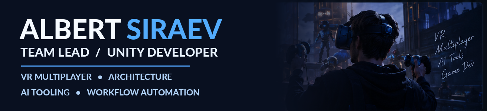
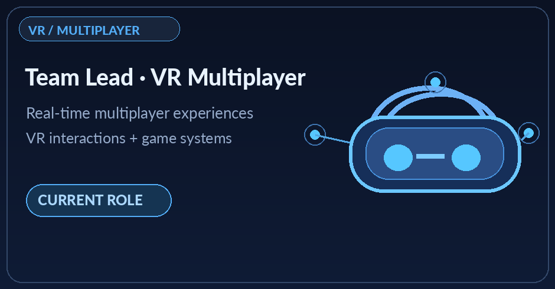
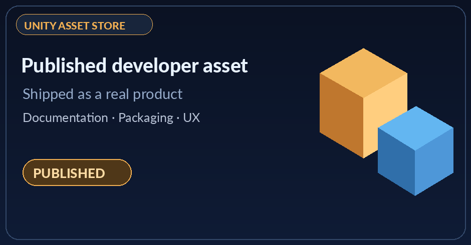
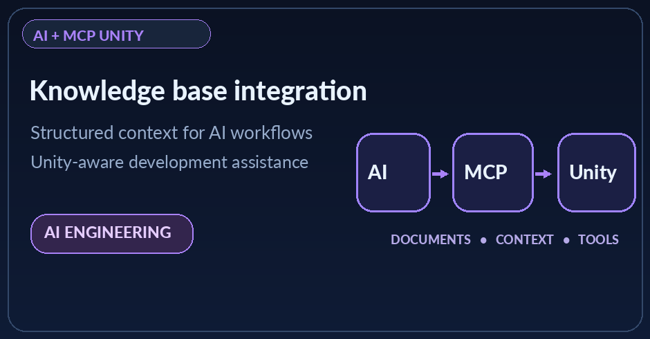
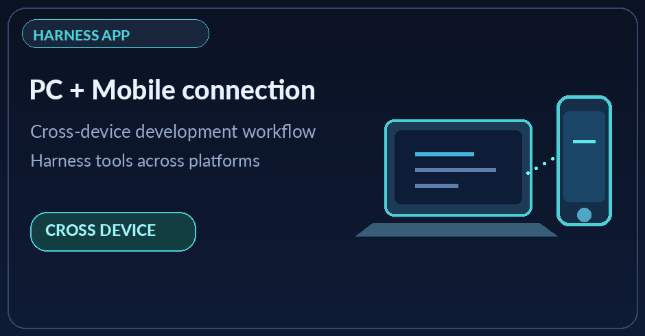
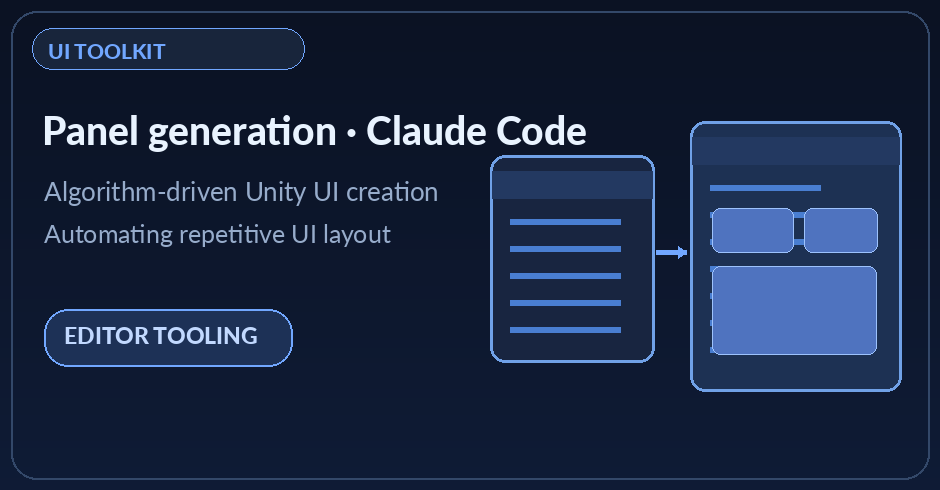

 

**Team Lead Unity Developer · VR / AR · Multiplayer · Developer Tools**

## Hi, I'm Albert

I am a **Unity Developer and Team Lead with 5+ years of experience** delivering VR/AR, multiplayer and cross-platform applications. I design technical architecture, lead Unity teams, solve performance bottlenecks, and build tools that streamline the development process.

I'm currently a **Team Lead Unity Developer at a Dubai-based company**, working on a **VR multiplayer game**. I also collaborate with the art lead to turn client requirements into production scenarios and interactive experiences.

Beyond game development, I build **AI-powered Unity workflows**, including knowledge systems, MCP integration, harness tooling and UI automation.

## Selected impact

<table>
<tr>
<td align="center" width="25%"><b>5+ years</b> Unity development</td>
<td align="center" width="25%"><b>50 players</b> Multiplayer systems</td>
<td align="center" width="25%"><b>~20 → 60 FPS</b> Console optimization</td>
<td align="center" width="25%"><b>1–2 MB → ~40 KB</b> GC allocations</td>
</tr>
</table>

- Led a team of **5 Unity engineers**, owned technical direction and multiplayer architecture.
- Built a reusable **UPM framework**, cutting new-project setup time by **30–40%**.
- Improved mobile rendering performance by **20%** and helped ship live applications used by **50k+ users**.
- Delivered across **VR/AR, PC, WebGL, iOS, Android and console platforms**.

Selected results are from previous projects and roles; figures refer to different products.

## Featured work

<table>
<tr>
<td width="47%"></td>
<td width="53%">
<h3>VR Multiplayer · Current role</h3>
<b>Team Lead Unity Developer · Dubai-based company</b>

Leading Unity development for a VR multiplayer experience and collaborating with the art lead on scenarios derived from client requirements.

<b>Current tools:</b> Addressables, Final IK, UI Toolkit, VContainer.

<i>Commercial project — public details and visuals are limited.</i>

</td>
</tr>
<tr>
<td width="47%"></td>
<td width="53%">
<h3>Unity Asset Store · Under Review</h3>

Created a Unity editor asset and submitted it for review on the Unity Asset Store.

<b>Focus:</b> reusable tooling, product packaging and developer experience.

<a href="https://u3d.as/4eLq"><b>View on Unity Asset Store ↗</b></a> <i>(listing pending approval)</i>

</td>
</tr>
<tr>
<td width="47%"></td>
<td width="53%">
<h3>AI Knowledge Base + MCP Unity</h3>

Designed an AI knowledge base integrated with MCP Unity to support AI-assisted work in the Unity development environment.

<b>Focus:</b> project knowledge, AI context and development workflow integration.

</td>
</tr>
<tr>
<td width="47%"></td>
<td width="53%">
<h3>Harness Companion App · PC + Mobile</h3>

Developed an application for working with an AI harness across desktop and mobile devices, enabling a connected cross-device workflow.

<b>Focus:</b> developer productivity, tool integration and cross-device interaction.

</td>
</tr>
<tr>
<td width="47%"></td>
<td width="53%">
<h3>UI Toolkit Panel Generator</h3>

Created an algorithm that generates Unity UI Toolkit panels using Claude Code.

<b>Focus:</b> AI-assisted UI creation and automation of repetitive editor work.

</td>
</tr>
</table>

## Technical toolkit

**Unity and architecture**  
`C#` · `Unity` · `VContainer` · `Addressables` · `UI Toolkit` · `Final IK` · `Modular Architecture` · `UPM`

**Multiplayer and performance**  
`Mirror` · `FishNet` · `Networking` · `Unity Jobs` · `Burst` · `GC Optimization` · `Rendering`

**Tools, backend and automation**  
`Claude Code` · `MCP Unity` · `AI Knowledge Systems` · `Python` · `Django REST` · `PostgreSQL` · `Docker` · `GitLab CI/CD`

**Platforms**  
`VR/AR` · `Windows/PC` · `WebGL` · `Android` · `iOS` · `PlayStation` · `Xbox` · `Nintendo Switch`

## Experience at a glance

- **Current:** Team Lead Unity Developer — Dubai-based company · VR Multiplayer.
- **2025–2026:** Contract Unity Developer — cross-platform apps, console porting, backend and performance work.
- **2024–2025:** Unity Developer Team Lead, Square Dino LLC — multiplayer architecture and team leadership.
- **2023–2024:** Unity Developer / Tech Lead, BCSports XR — VR multiplayer, Telegram Mini Apps and optimization.
- **2021–2023:** Unity Developer, Skyce LLC — VR experiences, simulation and mobile applications.

## Let's connect

<!-- TODO: Add LinkedIn, Telegram and portfolio URLs if you want them shown. -->

Artwork in this profile is illustrative, not screenshots of confidential commercial projects. Actual demos and public links can be added as they become available.
